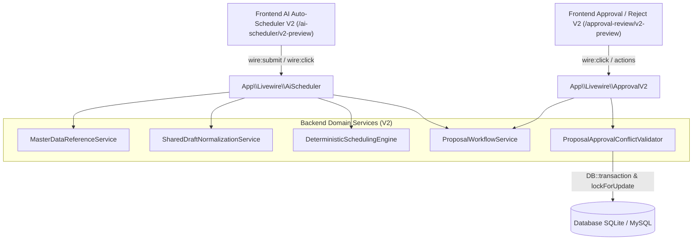
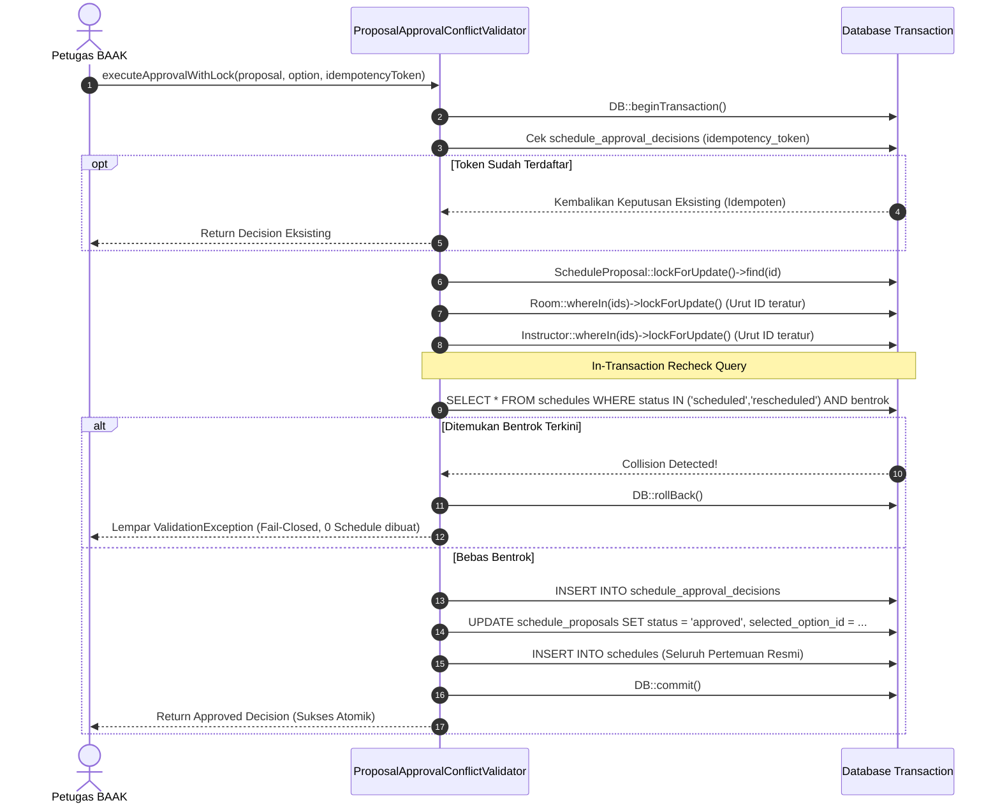

# KONTRAK INTERFACE & SERVICE BACKEND V2 (GATE D4-CONTRACT)
## SPESIFIKASI INTEGRASI PENJADWALAN KELAS & APPROVAL BAAK

**Nomor Kontrak:** `PALCOM-BE-HANDOFF-1.0` (Implementasi Deliverable Gate D4)  
**Proyek:** PALCOM AI SCHEDULER V2  
**Gerbang:** Gate D4-CONTRACT (Interface & Service Backend Contract)  
**Branch Kerja:** `feat/a2-db-v2`  
**Commit Acuan Frontend Project Leader:** `0a4fcc03ba1e2cdda2e726193aca75323cb112aa` (`/ai-scheduler/v2-preview`)  
**Tanggal:** 16 Oktober 2026  
**Penanggung Jawab:** Kanero (Anggota 2) — Backend, Database & Validation  
**Pemberi Keputusan / Reviewer:** Project Leader / Anggota 1  
**Status Dokumen:** **DOKUMEN KONTRAK RESMI UNTUK REVIEW & PERSETUJUAN PROJECT LEADER**  

> **Pernyataan Batas Kerja (Scope Boundary):**  
> Sesuai Bagian 4 & 11 kontrak `PALCOM-BE-HANDOFF-1.0`, dokumen ini membekukan kontrak semantik, struktur antarmuka, format respons, logika deterministik, dan rancangan pengujian backend. Dokumen ini **belum mengaktifkan endpoint produksi, integrasi AI eksternal, atau modifikasi branch utama**. Implementasi kode baru mengikuti gate bertahap: G3-SCHEDULING, G4-APPROVAL, G5-AI, dan INTEGRATION.

---

## 1. Peta Service, Controller, Livewire Actions, dan Endpoint

Komunikasi antara frontend baru (`/ai-scheduler/v2-preview` dan `/approval-review/v2-preview`) dengan backend dijalankan secara reaktif melalui **Livewire 4 Component Actions**, dengan lapisan service backend modular dan dukungan fallback REST API JSON.



### 1.1 Pemetaan Livewire Component Actions

#### A. Komponen Auto-Scheduler AO: `App\Livewire\AiScheduler`
* **Route:** `/ai-scheduler/v2-preview`
* **Actions:**
  1. `loadReferences(string $department)`: Mengambil data master program, kurikulum, fasilitas, dan kompetensi yang diizinkan untuk formulir.
  2. `generateScheduleOptions()`: Menjalankan validasi draft form (baik dari tab AI Assistant maupun Input Manual), memanggil engine deterministik, dan merender kartu Opsi A, B, C.
  3. `selectOption(int $optionId)`: Mengikat opsi yang dipilih AO pada state reaktif komponen.
  4. `submitProposal()`: Menyimpan proposal ke database dengan status `pending` dan mengosongkan form / menampilkan notifikasi sukses pengajuan.

#### B. Komponen Approval / Reject BAAK: `App\Livewire\ApprovalV2`
* **Route:** `/approval-review/v2-preview` *(diselaraskan dengan route preview frontend, rute legacy tidak diubah)*
* **Tab Navigasi (Tepat 2 Tab Sesuai Kontrak Bagian 7):**
  - **Tab 1: `new_schedules` (Pengajuan Jadwal Baru):** Menampilkan antrean proposal gabungan Komputer & SpeakOut.
  - **Tab 2: `instructor_leaves` (Pengajuan Izin Instruktur):** Mempertahankan seluruh alur dan service existing (`ScheduleApprovalService` & `API_CONTRACT_SCHEDULER.md`).
  *(Tidak ada tab ketiga "Semua").*
* **Actions Tab 1:**
  1. `loadTab(string $tab)`: Berpindah antara tab `new_schedules` dan `instructor_leaves`.
  2. `showProposalDetail(int $proposalId)`: Menampilkan drawer/modal detail proposal, seluruh pertemuan, dan riwayat review.
  3. `approveProposal(int $proposalId, string $idempotencyToken, ?string $reason = null)`: Menjalankan approval atomik transaksional.
  4. `requestRevision(int $proposalId, string $reason)`: Mengubah status proposal menjadi `needs_revision` dan mencatat alasan BAAK.
  5. `rejectProposal(int $proposalId, string $reason)`: Mengubah status proposal menjadi `rejected` (terminal).

---

### 1.2 Rancangan Endpoint REST API Fallback (Headless / Testing)

| Operasi Logis Kontrak | Endpoint HTTP | Method | Otorisasi (RBAC) | Fungsi Layanan |
| :--- | :--- | :---: | :---: | :--- |
| `getSchedulingReferences` | `/api/v2/scheduling/references` | `GET` | AO, BAAK, Admin | Master data nyata sesuai departemen |
| `normalizeSchedulingDraft` | `/api/v2/scheduling/normalize-draft` | `POST` | AO, BAAK | Validasi & normalisasi struktur draft |
| `findScheduleAlternatives` | `/api/v2/scheduling/alternatives` | `POST` | AO, BAAK | Engine deterministik opsi A, B, C |
| `getScheduleOptionDetail` | `/api/v2/scheduling/options/{id}` | `GET` | AO, BAAK | Detail seluruh pertemuan & justifikasi opsi |
| `submitScheduleProposal` | `/api/v2/schedule-proposals` | `POST` | AO | Menyimpan proposal `pending` tanpa reservasi |
| `listScheduleProposals` | `/api/v2/schedule-proposals` | `GET` | BAAK, Admin | Antrean BAAK dengan filter & paginasi |
| `getScheduleProposalDetail` | `/api/v2/schedule-proposals/{id}` | `GET` | AO (milik sendiri), BAAK | Detail proposal, opsi terpilih, & riwayat |
| `reviewScheduleProposal` | `/api/v2/schedule-proposals/{id}/decide` | `POST` | BAAK | Keputusan BAAK: approve / revise / reject |
| `getOwnProposals` | `/api/v2/my-proposals` | `GET` | AO | Daftar proposal milik AO yang login |

---

## 2. Data Dictionary & Pemetaan Model Database ke Field Frontend

Untuk memastikan integritas tanpa mengubah frontend yang sudah disetujui pada commit `0a4fcc0`, tabel berikut menetapkan mapping eksplisit antara field frontend dan kolom database:

| Field Frontend UI | Tipe Data Frontend | Kolom & Tabel Database | Tipe Data Database | Aturan & Keterangan Mapping |
| :--- | :--- | :--- | :--- | :--- |
| `input_mode` | `string` | `schedule_proposals.input_mode` | `enum('ai_assistant','manual_input')` | Identik, wajib diisi. |
| `title` | `string` | `schedule_proposals.title` | `varchar(255)` | Judul kelas / pengajuan. |
| `department` | `string` | `schedule_proposals.department` | `enum('computer','speakout')` | Bidang studi. |
| `class_kind` | `string` | `schedule_proposals.class_kind` | `enum('regular','private')` | Jenis kelas. |
| `program_id` | `integer` | `schedule_proposals.program_id` | `foreignId -> programs.id` | Program studi resmi (nullable). |
| `curriculum_version_id` | `integer` | `schedule_proposals.curriculum_version_id` | `foreignId -> curriculum_versions.id` | Versi kurikulum *published* (nullable). |
| `student_count` | `integer` | `schedule_proposals.student_count` | `integer unsigned` | Jumlah siswa (constraint kapasitas ruang). |
| `start_date` | `string (YYYY-MM-DD)` | `schedule_proposals.start_date` | `date` | Tanggal mulai kelas. |
| `end_date` | `string (YYYY-MM-DD)` | `schedule_proposals.end_date` | `date` | Tanggal selesai kelas. |
| `total_meetings` | `integer` | `schedule_proposals.total_meetings` | `integer unsigned` | Target jumlah pertemuan kelas. |
| `frequency_per_week` | `integer` | `schedule_proposals.frequency_per_week` | `integer unsigned` | Frekuensi pertemuan per minggu. |
| `session_duration_minutes` | `integer` | `schedule_proposals.session_duration_minutes` | `integer unsigned` | Durasi belajar per sesi (menit). |
| `preferred_weekdays` | `array` | `schedule_proposals.preferred_weekdays` | `json` | Array hari: `["Senin", "Rabu"]`. |
| `preferred_time_window` | `object {start, end}` | `schedule_proposals.preferred_time_window` | `json` | Objek jam: `{"start":"08:00","end":"12:00"}`. |
| `preferred_instructor_id` | `integer|null` | `schedule_proposals.preferred_instructor_id` | `foreignId -> instructors.id` | `null` = pilih otomatis oleh engine. |
| `preferred_room_id` | `integer|null` | `schedule_proposals.preferred_room_id` | `foreignId -> rooms.id` | `null` = pilih otomatis oleh engine. |
| `required_competency_ids`| `array [int]` | `schedule_proposals.required_competency_ids` | `json` | Filter kompetensi materi kurikulum. |
| `required_facility_codes`| `array [string]` | `schedule_proposals.required_facility_codes` | `json` | Filter fasilitas: `["FAC-AC", "FAC-LAN"]`. |
| `facility_notes` | `string|null` | `schedule_proposals.facility_notes` | `text` | Catatan fasilitas non-constraint. |
| `ai_prompt` | `string|null` | `schedule_proposals.ai_prompt` | `text` | Teks prompt asli pengguna mode AI. |
| `recurring_patterns` | `array [object]` | Tabel `recurring_patterns` | Relasi hasMany | Format: `day_of_week`, `start_time`, `end_time`. |
| `options` (A/B/C) | `array` | Tabel `schedule_proposal_options` | Relasi hasMany | `option_label`, `score`, `payload`, `conflicts`. |
| `selected_option_id` | `integer|null` | `schedule_proposals.selected_option_id` | `foreignId` (composite FK) | Opsi terpilih (wajib milik proposal sama). |

---

## 3. Contoh Request & Response Nyata (Semua Operasi Bagian 4–9)

Seluruh payload di bawah menggunakan ID nyata dari database demo PalComTech:

### 3.1 Draft Valid (`normalizeSchedulingDraft`)
**Request:**
```json
{
  "input_mode": "ai_assistant",
  "department": "computer",
  "program_id": 1,
  "curriculum_version_id": 1,
  "class_kind": "regular",
  "student_count": 20,
  "start_date": "2026-11-23",
  "end_date": "2027-02-15",
  "total_meetings": 24,
  "session_duration_minutes": 120,
  "frequency_per_week": 2,
  "preferred_weekdays": ["Senin", "Rabu"],
  "preferred_time_window": {"start": "08:00", "end": "12:00"},
  "required_competency_ids": [1],
  "required_facility_codes": ["FAC-AC", "FAC-LAN"],
  "ai_prompt": "Jadwal pagi instruktur web senior dan lab koneksi LAN stabil."
}
```
**Response (HTTP 200):**
```json
{
  "valid": true,
  "normalized_draft": {
    "title": "Kelas Web Programming Pagi Reguler",
    "department": "computer",
    "program_id": 1,
    "program_name": "Web Programming",
    "curriculum_version_id": 1,
    "student_count": 20,
    "start_date": "2026-11-23",
    "end_date": "2027-02-15",
    "total_meetings": 24,
    "session_duration_minutes": 120,
    "frequency_per_week": 2,
    "preferred_weekdays": ["Senin", "Rabu"],
    "preferred_time_window": {"start": "08:00", "end": "12:00"},
    "required_competency_ids": [1],
    "required_facility_codes": ["FAC-AC", "FAC-LAN"]
  },
  "errors": []
}
```

---

### 3.2 Draft Tidak Lengkap
**Response (HTTP 422 Unprocessable Content):**
```json
{
  "valid": false,
  "message": "Validasi draft penjadwalan gagal.",
  "errors": {
    "student_count": ["Jumlah siswa wajib diisi dan minimal 1."],
    "preferred_weekdays": ["Pilih minimal satu hari preferensi belajar."],
    "start_date": ["Tanggal mulai tidak boleh berada di masa lalu."]
  }
}
```

---

### 3.3 Opsi Rekomendasi Ditemukan (`findScheduleAlternatives`)
**Response (HTTP 200 - Maksimal 3 Opsi A/B/C):**
```json
{
  "alternatives_count": 2,
  "options": [
    {
      "option_label": "A",
      "score": 95,
      "conflicts_count": 0,
      "explanation": "Rekomendasi Utama: Jadwal konsisten setiap Senin & Rabu 09:00-11:00 di Lab Komputer 1 dengan Instruktur Wahyu Setiawan. Bebas bentrok.",
      "proposed_schedules_payload": [
        {
          "meeting_sequence": 1,
          "date": "2026-11-23",
          "day_name": "Senin",
          "start_time": "09:00:00",
          "end_time": "11:00:00",
          "room_id": 1,
          "room_name": "Lab Komputer 1",
          "instructor_id": 1,
          "instructor_name": "Wahyu Setiawan",
          "curriculum_subject_id": 1,
          "subject_name": "Web Programming Dasar"
        },
        {
          "meeting_sequence": 2,
          "date": "2026-11-25",
          "day_name": "Rabu",
          "start_time": "09:00:00",
          "end_time": "11:00:00",
          "room_id": 1,
          "room_name": "Lab Komputer 1",
          "instructor_id": 1,
          "instructor_name": "Wahyu Setiawan",
          "curriculum_subject_id": 1,
          "subject_name": "Web Programming Dasar"
        }
      ]
    },
    {
      "option_label": "B",
      "score": 88,
      "conflicts_count": 0,
      "explanation": "Alternatif Ruang: Menggunakan Lab Komputer 2 pada jam yang sama.",
      "proposed_schedules_payload": [ ... ]
    }
  ]
}
```

---

### 3.4 Tidak Ada Opsi Valid (Zero-Option)
**Response (HTTP 200 - Zero Option Terverifikasi):**
```json
{
  "alternatives_count": 0,
  "options": [],
  "reasons": [
    "Seluruh ruangan berstatus maintenance atau kapasitas di bawah 35 siswa pada rentang jam tersebut.",
    "Tidak ada instruktur aktif dengan kompetensi Web Programming Dasar yang tersedia pada hari Minggu."
  ]
}
```

---

### 3.5 Proposal Dikirim AO (`submitScheduleProposal`)
**Response (HTTP 201 Created):**
```json
{
  "success": true,
  "message": "Proposal jadwal berhasil diajukan dan menunggu persetujuan BAAK.",
  "proposal": {
    "id": 8,
    "title": "Kelas Web Programming Pagi Reguler",
    "status": "pending",
    "requested_by": 2,
    "requester_name": "AO Staff Palcomtech",
    "submitted_at": "2026-10-16 18:45:00",
    "selected_option_label": "A",
    "is_official_reserved": false
  }
}
```
*(Catatan: `is_official_reserved: false`, belum ada row `schedules` resmi yang terbuat).*

---

### 3.6 Detail Proposal untuk Antrean Review BAAK (`getScheduleProposalDetail`)
**Response (HTTP 200):**
```json
{
  "proposal_id": 8,
  "title": "Kelas Web Programming Pagi Reguler",
  "department": "computer",
  "class_kind": "regular",
  "student_count": 20,
  "total_meetings": 24,
  "start_date": "2026-11-23",
  "end_date": "2027-02-15",
  "status": "pending",
  "requester": {
    "id": 2,
    "name": "AO Staff Palcomtech",
    "role": "ao"
  },
  "selected_option": {
    "option_id": 15,
    "option_label": "A",
    "score": 95,
    "conflicts_count": 0
  },
  "meetings": [
    {
      "sequence": 1,
      "date": "2026-11-23",
      "time": "09:00:00 - 11:00:00",
      "room": "Lab Komputer 1",
      "instructor": "Wahyu Setiawan"
    }
  ],
  "validation": {
    "has_conflicts": false,
    "conflicts": []
  },
  "decision_history": []
}
```

---

### 3.7 Approval Berhasil oleh BAAK (`reviewScheduleProposal`)
**Request:**
```json
{
  "decision": "approved",
  "reason": "Jadwal dan instruktur telah diverifikasi BAAK.",
  "idempotency_token": "token-baak-approval-20261016-008"
}
```
**Response (HTTP 200):**
```json
{
  "success": true,
  "proposal_id": 8,
  "status": "approved",
  "decision": "approved",
  "decided_by": "BAAK Administrator",
  "decided_at": "2026-10-16 18:50:00",
  "official_schedules_created": 24,
  "schedule_ids": [101, 102, 103, 104, 105, 106, 107, 108, 109, 110, 111, 112, 113, 114, 115, 116, 117, 118, 119, 120, 121, 122, 123, 124]
}
```

---

### 3.8 Approval Konflik (Ditolak Fail-Closed)
**Response (HTTP 422 Unprocessable Content):**
```json
{
  "success": false,
  "message": "Persetujuan proposal ditolak karena ditemukan bentrok terkini pada 2026-11-23 (Lab Komputer 1): Ruangan telah terisi oleh jadwal resmi lain (ID #42) pada jam tersebut.",
  "errors": {
    "approval": ["Persetujuan proposal ditolak karena ditemukan bentrok terkini pada 2026-11-23 (Lab Komputer 1): Ruangan telah terisi oleh jadwal resmi lain (ID #42) pada jam tersebut."]
  },
  "official_schedules_created": 0
}
```
*(Catatan: Transaksi rollback atomik, 0 baris jadwal resmi yang tersimpan).*

---

### 3.9 Permintaan Revisi BAAK (`needs_revision`)
**Request:**
```json
{
  "decision": "needs_revision",
  "reason": "Lab Komputer 1 sedang dijadwalkan maintenance jaringan pada minggu kedua. Mohon ganti ke Lab Komputer 2."
}
```
**Response (HTTP 200):**
```json
{
  "success": true,
  "proposal_id": 8,
  "status": "needs_revision",
  "round": 1,
  "reason": "Lab Komputer 1 sedang dijadwalkan maintenance jaringan pada minggu kedua. Mohon ganti ke Lab Komputer 2.",
  "is_open_for_revising": true
}
```

---

### 3.10 Akses Tidak Sah (Otorisasi Ditolak)
**Response (HTTP 403 Forbidden):**
```json
{
  "success": false,
  "message": "Otorisasi ditolak: Hanya pengguna dengan peran BAAK yang memiliki wewenang untuk menyetujui, menolak, atau meminta revisi pengajuan jadwal resmi.",
  "error_code": "RBAC_UNAUTHORIZED_ACTION"
}
```

---

### 3.11 AI API Gagal / Fallback Deterministik
**Response (HTTP 200 - Graceful Fallback):**
```json
{
  "ai_status": "fallback_deterministic",
  "ai_notice": "Layanan AI asisten sedang mengalami antrean tinggi. Rekomendasi jadwal dihasilkan melalui Engine Deterministik berbasis aturan resmi kampus.",
  "alternatives_count": 2,
  "options": [ ... ]
}
```

---

## 4. Matriks Status, Transisi Siklus Hidup & RBAC

### 4.1 Definisi Status Domain

| Kategori | Status | Keterangan | Memblokir Resource? |
| :--- | :--- | :--- | :---: |
| **Proposal** | `draft` | Sedang diedit oleh AO, belum dikirim. | **TIDAK** |
| | `pending` | Diajukan ke BAAK, menunggu review. | **TIDAK** |
| | `needs_revision` | BAAK meminta revisi ruang/waktu. | **TIDAK** |
| | `approved` | Disetujui BAAK, jadwal resmi terbit. | **TIDAK** *(schedules yang memblokir)* |
| | `rejected` | Ditolak final oleh BAAK. | **TIDAK** |
| **Kelas Resmi** | `planned` | Terdaftar resmi, persiapan belajar. | **TIDAK** |
| | `active` | Perkuliahan sedang berjalan aktif. | **TIDAK** |
| | `completed` | Seluruh pertemuan telah selesai. | **TIDAK** |
| | `cancelled` | Kelas dibatalkan institusi. | **TIDAK** |
| **Jadwal Pertemuan** | `scheduled` | Pertemuan resmi terdaftar. | **YA (BLOKIR RESOURCE)** |
| | `rescheduled` | Pertemuan resmi dipindahkan waktu/ruang. | **YA (BLOKIR RESOURCE)** |
| | `completed` | Pertemuan telah terlaksana. | **TIDAK** |
| | `cancelled` | Pertemuan dibatalkan resmi. | **TIDAK** |
| | `postponed` | Pertemuan ditunda sementara. | **TIDAK** |

---

### 4.2 Matriks Hak Akses (RBAC)

| Peran (Role) | Buat Draft & Cari Opsi | Ajukan Proposal | Lihat Proposal Sendiri | Lihat Semua Antrean | Approve / Revise / Reject | Eksekusi Jadwal Resmi |
| :--- | :---: | :---: | :---: | :---: | :---: | :---: |
| **`ao`** | ✅ | ✅ | ✅ | ❌ | ❌ | ❌ |
| **`baak`** | ✅ | ❌ | ✅ | ✅ | ✅ | ✅ |
| **`instructor`** | ❌ | ❌ | ❌ | ❌ | ❌ | ❌ |
| **`admin`** | ✅ | ❌ | ✅ | ✅ *(Read Only)* | ❌ *(Kecuali punya role baak)* | ❌ |
| **`staff`** | ❌ | ❌ | ❌ | ❌ | ❌ | ❌ |

---

## 5. Algoritma Engine, Hard Constraints, Ranking & Zero-Option

Sumber kebenaran validitas jadwal adalah **Scheduling Engine Deterministik**, bukan halusinasi keluaran model bahasa (AI).

### 5.1 Generator Tanggal Pertemuan
Engine menghitung seluruh tanggal pertemuan secara deterministik mulai dari `start_date` berdasarkan array hari `preferred_weekdays` hingga mencapai `total_meetings`.

### 5.2 Hard Constraints (Eliminasi Mutlak)
Sebuah kandidat slot **dieliminasi secara mutlak** jika salah satu dari kondisi berikut dilanggar:
1. `room.department === proposal.department` (Isolasi bidang Komputer vs SpeakOut).
2. `room.capacity >= proposal.student_count` (Kapasitas mencukupi).
3. `room.status === 'available'` (Bukan berstatus `maintenance`).
4. Ruangan memiliki seluruh fasilitas yang diminta (`required_facility_codes`) dengan kondisi `good`.
5. `instructor.department === proposal.department` dan `instructor.status === 'active'`.
6. Instruktur menguasai seluruh kompetensi kurikulum yang diminta (`required_competency_ids`).
7. Jam pertemuan berada di dalam slot mingguan ketersediaan mengajar instruktur (`instructor_availabilities`).
8. Instruktur tidak memiliki permohonan izin/cuti yang disetujui (`instructor_leaves`) pada jam tersebut.
9. **Zero Double-Booking Check:** Tidak terdapat baris `schedules` berstatus `scheduled` atau `rescheduled` yang bertabrakan pada rentang waktu setengah-terbuka:
   $$\text{start\_time} < \text{other.end\_time} \quad \land \quad \text{end\_time} > \text{other.start\_time}$$

### 5.3 Rumus Skor Rekomendasi (Ranking Formula)
Alternatif yang lolos seluruh *hard constraints* diurutkan berdasarkan skor kualitas deterministik dengan formula:
$$\text{RawScore} = \text{BaseScore} (85) - \text{Penalty}_{\text{drift}} + \text{Bonus}_{\text{room\_consistency}} + \text{Bonus}_{\text{seniority}}$$
$$\text{FinalScore} = \text{clamp}(0, 100, \text{RawScore}) = \max(0, \min(100, \text{RawScore}))$$

* **$\text{BaseScore}$:** 85 poin untuk setiap alternatif yang lolos seluruh *hard constraints* (bebas bentrok).
* **$\text{Penalty}_{\text{drift}}$ (Penalti Pergeseran Waktu):** Mengurangi $-5$ poin untuk setiap 30 menit deviasi akumulatif dari jendela waktu ideal yang diminta AO (`preferred_time_window`). Penalti ini secara tegas mengurangi skor opsi yang bergeser dari jam yang diinginkan sehingga alternatif dengan waktu paling sesuai selalu mendapatkan peringkat lebih tinggi.
* **$\text{Bonus}_{\text{room\_consistency}}$ (Bonus Konsistensi Ruangan):** $+10$ poin jika dan hanya jika **seluruh pertemuan** dari pertemuan pertama hingga pertemuan ke-$N$ (`total_meetings`) dapat dilaksanakan di ruangan lab yang sama secara konsisten tanpa perpindahan ruangan.
* **$\text{Bonus}_{\text{seniority}}$ (Bonus Kemahiran Instruktur):** $+5$ poin jika instruktur memiliki tingkat penguasaan materi `expert` / jam terbang tinggi pada kompetensi kurikulum yang diajarkan.
* **Jaminan Rentang Nilai:** Nilai akhir dipastikan berada pada rentang tertutup $[0, 100]$ melalui fungsi pembatas (*clamping*), sehingga skor tidak pernah bernilai negatif dan tidak melebihi 100.

### 5.4 Protokol Zero-Option
Jika tidak ada kombinasi instruktur, ruangan, dan waktu yang lolos seluruh hard constraint, engine **dilarang mengarang jadwal** dan wajib mengembalikan:
- `options: []`
- Array `reasons` berisi daftar kendala spesifik penyebab kegagalan (misal: "Seluruh lab komputer terisi pada jam 09:00", "Ruang tersedia kapasitasnya 12 sedangkan kelas membutuhkan 20").

---

## 6. Strategi Transaksi, Concurrency Locking & Idempotensi

Untuk mencegah double-booking pada persaingan dua transaksi independen:



* **Urutan Kunci Teratur (*Ordered Locking*):** Untuk mencegah deadlock di MySQL/PostgreSQL, ID ruangan dan instruktur selalu diurutkan secara menaik (`sort()`) sebelum dipanggil `lockForUpdate()`.

---

## 7. Matriks Minimal Acceptance Tests per Service

| Service / Komponen | Berkas Test yang Direncanakan | Skenario Pengujian Kritis |
| :--- | :--- | :--- |
| `MasterDataReferenceService` | `tests/Feature/Scheduling/MasterDataReferenceTest.php` | • Isolasi departemen Komputer vs SpeakOut.<br>• Hanya kurikulum berstatus `published` yang muncul.<br>• Hanya ruangan `available` dan fasilitas `good` yang terambil. |
| `SharedDraftNormalizationService` | `tests/Feature/Scheduling/SharedDraftNormalizationTest.php` | • Validasi field wajib, tanggal masa lalu ditolak.<br>• Format waktu 24 jam `Asia/Jakarta` ternormalisasi.<br>• Pemetaan konsisten antara AI Assistant dan Input Manual. |
| `DeterministicSchedulingEngine` | `tests/Feature/Scheduling/DeterministicSchedulingEngineTest.php` | • Generator menghitung 24 pertemuan tepat sesuai hari.<br>• Eliminasi ruangan kapasitas kecil dan status maintenance.<br>• Eliminasi instruktur beda bidang dan sedang cuti/izin.<br>• Mengembalikan tepat 0 opsi jika tidak ada solusi valid. |
| `ProposalWorkflowService` | `tests/Feature/Scheduling/ProposalWorkflowTest.php` | • Proposal AO tersimpan berstatus `pending` tanpa membuat row `schedules`.<br>• Opsi terpilih wajib milik proposal yang sama (composite FK integrity).<br>• AO hanya dapat membaca proposal miliknya sendiri. |
| `ProposalApprovalConflictValidator` | `tests/Feature/Scheduling/ProposalApprovalWorkflowTest.php` | • Approval BAAK membuat seluruh jadwal resmi secara atomik.<br>• Persaingan dua transaksi konkuren menolak proposal kedua (0 double-booking).<br>• Token idempoten mencegah pencatatan ganda saat double click.<br>• Status `needs_revision` mencatat riwayat putaran lama tanpa menghapus audit trail. |

---

## 8. Daftar Berkas, Dependensi, Risiko Tabrakan & Rencana Integrasi

### 8.1 Berkas Baru yang Akan Dibuat pada Gate Berikutnya (G3 & G4)
1. `app/Services/Scheduling/MasterDataReferenceService.php`
2. `app/Services/Scheduling/SharedDraftNormalizationService.php`
3. `app/Services/Scheduling/DeterministicSchedulingEngine.php`
4. `app/Services/Scheduling/ProposalWorkflowService.php`
5. `app/Http/Controllers/Api/V2/SchedulingApiController.php`
6. `app/Policies/ScheduleProposalPolicy.php`

### 8.2 Berkas yang Diperbarui (Non-Destructive)
1. `app/Services/Scheduling/ProposalApprovalConflictValidator.php` *(telah disiapkan di Gate D2 & D3)*
2. `routes/web.php` & `routes/api.php` *(hanya menambahkan rute V2 tanpa menyentuh rute lama)*
3. `app/Livewire/AiScheduler.php` *(diintegrasikan ke service backend baru tanpa mengubah Blade UI commit `0a4fcc0`)*

### 8.3 Mitigasi Risiko Tabrakan (*Collision Risk*)
* **Rute AI Auto-Scheduler:** Frontend baru berada di `/ai-scheduler/v2-preview`. Rute legacy `/ai-scheduler` tetap utuh.
* **Modul Izin Instruktur:** Tabel `schedule_substitutions`, status, serta kontrak `API_CONTRACT_SCHEDULER.md` dijamin 100% kompatibel dan tidak mengalami modifikasi.
* **Integrasi Git:** Seluruh pekerjaan dikembangkan pada branch `feat/a2-db-v2`. Tidak ada rebase destruktif, force-push, atau merge ke `main` lokal Project Leader tanpa izin.

---

## 9. Decision Register untuk Persetujuan Project Leader

| No | Poin Keputusan | Usulan Anggota 2 | Status Resmi Project Leader |
| :---: | :--- | :--- | :---: |
| **DR-01** | **Strategi Penanganan AI Timeout** | Jika API AI eksternal timeout (> 5 detik) atau kuota habis, backend secara elegan beralih (*failover*) ke engine deterministik tanpa memicu error fatal pada UI AO. | **DISETUJUI (APPROVED)** |
| **DR-02** | **Proposal Kedaluwarsa (*Stale Proposals*)** | Jika BAAK me-review proposal yang `start_date`-nya sudah terlewati dari hari ini, sistem memberi peringatan dan mewajibkan AO memperbarui tanggal sebelum dapat disetujui. | **DISETUJUI (APPROVED)** |
| **DR-03** | **Struktur Komponen Livewire Approval V2** | Komponen Approval V2 dibuat modular dengan tepat 2 tab: Tab 1 `new_schedules` (Proposal Baru) dan Tab 2 `instructor_leaves` (Izin Instruktur Legacy) pada rute `/approval-review/v2-preview`, serta mempertahankan modul izin instruktur lama 100%. | **DISETUJUI (APPROVED)** |

---

## 10. Pernyataan Penutup

Dokumen Kontrak Interface & Service Backend V2 ini diajukan untuk menjadi acuan resmi implementasi pada gate berikutnya (**G3-SCHEDULING**). Anggota 2 berkomitmen untuk tidak memulai pengkodean logika orkestrasi sebelum dokumen ini disahkan oleh Project Leader.
